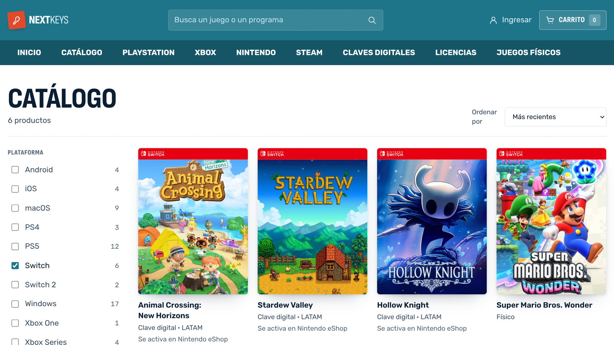
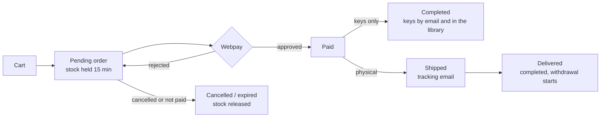
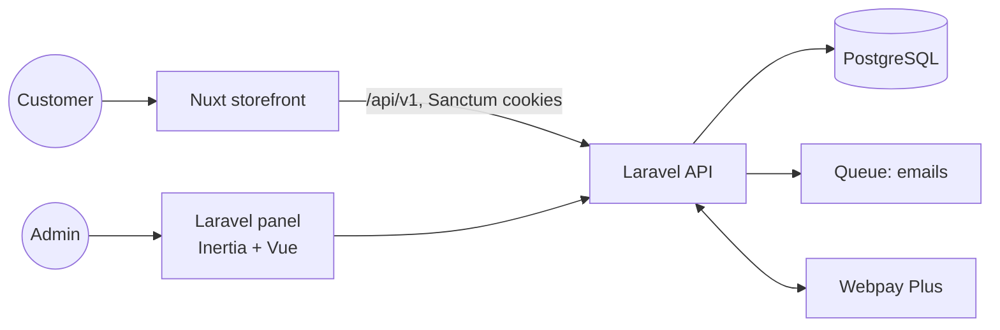

# NextKeys

A video game store for the Chilean market: digital keys, software licenses and physical games. Customers buy from a Nuxt storefront and pay with Transbank Webpay Plus. Admins run the catalog, the orders and the shipments from a Laravel panel.

> **Portfolio project.** The store is fictitious: payments run against Webpay's integration environment with test cards, and no product, key or shipment is real.



## What it does

- **Catalog.** One title, many variants: a Steam key, a PS5 key for Latin America and a boxed Switch game are different products with their own price, region and stock. Filters with live counts and an admin CRUD with bulk key import from CSV.
- **Cart and checkout.** The cart lives in a cookie; the API recomputes prices and stock. Placing an order holds the stock for 15 minutes with Postgres row locks, so two customers never get the same last key.
- **Payments.** Webpay Plus behind a `PaymentGateway` interface. The store confirms a charge only once it knows it can deliver: a late payment for an expired order without stock is never charged, and a reconciliation job refunds any charge that was not recorded.
- **Delivery.** Keys are delivered on payment, by email and in "My library", where codes are revealed on request and never appear in listings or logs. Physical games ship to a copy of the customer's address with a flat fee; the admin marks them as shipped (carrier and tracking number) and delivered, and the customer follows the parcel in the store.
- **Chilean rules.** Prices in CLP, the 16 regions and 346 communes for addresses, and the *derecho a retracto* shown before payment: none for delivered keys, 10 days from delivery for physical products.

## How a purchase works



Order and shipment transitions are enforced in the database (CHECK constraints and triggers), not only in the code. The decisions behind each part live in [`docs/domain`](docs/domain).

## Stack

| Part | Technology | Folder |
|---|---|---|
| API and admin panel | Laravel 13, Inertia 3, Vue 3, TypeScript, Fortify, Sanctum | [`apps/api`](apps/api) |
| Storefront (SSR) | Nuxt 4, TypeScript, Tailwind CSS 4, valibot | [`apps/web`](apps/web) |
| Payments | Transbank Webpay Plus (integration environment) | `apps/api/app/Payments` |
| Services | PostgreSQL 18, Redis 8, Mailpit (Docker) | [`docker-compose.yml`](docker-compose.yml) |



Laravel is the single source of truth: the storefront holds no business logic. The two apps share only `contracts/api/v1`, JSON fixtures that Laravel writes from real responses and the storefront parses with its valibot schemas, so a change in the API shape fails the tests on both sides.

## Quality

- **Tests:** Pest against PostgreSQL (600+ tests, including the database rules, row locking and "no key ever reaches a response or a log") and Vitest for the storefront.
- **Static analysis:** PHPStan with Larastan at level `max`, strict TypeScript in both apps, Pint, ESLint and Prettier.
- **One command per app**, the same one CI runs: `composer ci:check` in `apps/api` and `pnpm ci:check` in `apps/web` ([GitHub Actions](.github/workflows)).

## Run it locally

Requirements: PHP 8.5, Composer, Node, pnpm and Docker.

```bash
docker compose up -d
```

API and panel (`apps/api`):

```bash
composer setup
php artisan db:seed
php artisan storage:link
composer dev
```

Before seeding, set `ADMIN_EMAIL` and `ADMIN_PASSWORD` in `apps/api/.env` for the first admin, and `MAIL_MAILER=smtp` with Mailpit (`127.0.0.1:1025`): order emails refuse the `log` mailer, which would write keys and addresses to the log. `ORDERS_MANUAL_PAYMENTS=true` adds "mark as paid" to the panel, to try orders without Webpay.

Storefront (`apps/web`):

```bash
pnpm install
pnpm dev
```

| Service | URL |
|---|---|
| Storefront | http://localhost:3000 |
| API and admin panel | http://localhost:8000 |
| Mailpit (emails) | http://localhost:8025 |

The seed creates a test customer (`test@example.com`, password `password`) and a demo catalog. Game covers are not in the repository (copyrighted art): `php artisan catalog:import-covers` downloads them from IGDB with your own `IGDB_CLIENT_ID` and `IGDB_CLIENT_SECRET`.

Webpay's integration environment takes [Transbank's test cards](https://www.transbankdevelopers.cl/documentacion/como_empezar#tarjetas-de-prueba).

## Project status

Phases 0 to 5 are done: catalog, public API, orders and payments, storefront, and physical products. See the [roadmap](docs/ROADMAP.md).

## License

[MIT](LICENSE)
